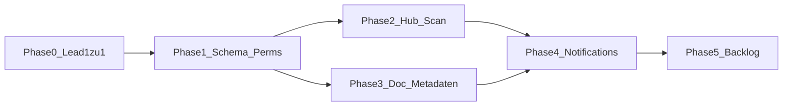

# Do11y – Umsetzungsphasen

**Policy (SSoT Produkt):** [Plan-Do11y-Docs-Observability.md](Plan-Do11y-Docs-Observability.md)  
**Todo:** [Umsetzungs-Todo §29](Umsetzungs-Todo.md#29-docs-observability-do11y-geplant)  
**UI:** EN **Freshness** · DE **Aktualität** · intern Do11y · App `/freshness` · API `/me/freshness`

Dieses Dokument steuert **Reihenfolge und Liefergrenzen**. Fachregeln nicht hier duplizieren – bei Konflikt gilt die Policy.

## Abhängigkeiten



**v1-Schnitt:** Phasen **0–3** = erstes nutzbares Feature (Hub + Scan + Aktionen + Intervall). **Phase 4** eng danach. **Phase 5** Backlog.

Phase 2 und 3 nach Phase 1 parallel möglich; Hub MVP darf bis Phase 3 den **Org-Default** nutzen, wenn Doc-Intervall-UI noch fehlt.

## Explizit nicht (bis Phase 5 / nie in v1)

- Personal-Scope in Do11y
- Health-Score / Ampel ohne Aktion
- Peer zu Most read in der Scope-Sidebar (nur Main-Hub)
- Alters-Banner für normale Leser
- Auto-Scan-Job vor Phase 5
- Admin-Board / Admin-Scan
- Landing-Buzzword „Observability“ vor Live-Hub

---

## Phase 0 – Lead-Kardinalität (Voraussetzung)

**Ziel:** Team und Department haben **genau einen** Lead (Hauptverantwortliche). Company: **mehrere** Leads bleiben erlaubt.

### Akzeptanz

- [x] POST gleicher Lead → 409 `ALREADY_*`; anderer User → atomares **Replace** (eine Zeile pro Scope, DB-PK)
- [x] DELETE letzter Team-/Department-Lead → 409 `LAST_*`
- [x] Anlegen Team/Department verlangt `leadUserId` (Create + Lead in einer Transaction)
- [x] Admin-UI: Create mit Pflicht-Lead; Save via Replace; Lead-Feld required
- [x] Company-Lead-APIs unverändert mehrfach erlaubt
- [x] **Bestandsdaten:** Migration dedupliziert (>1 → min `userId`); Scopes mit 0 Leads ohne Fake-User; Schema eine Zeile pro `teamId`/`departmentId`

### Anker

- [`assignments.routes.ts`](../../apps/backend/src/domains/organisation/routes/assignments.routes.ts)
- Admin Teams/Departments-Tabs
- [Rechtesystem §4](../platform/datenmodell/Rechtesystem.md)
- Todo auch unter [§9](Umsetzungs-Todo.md#9-admin-ui--nutzerverwaltung) – **eine** Story, nicht parallel widersprüchlich pflegen

### Tests

Assignment-API-Tests (max. einer, letzter nicht löschbar); ggf. UI-Smoke.

---

## Phase 1 – Fundament (Schema, Permissions, Platform-Default)

**Ziel:** Persistenz, Auswertungsregeln und Rechte – noch ohne Hub-UI (Admin-Settings-Felder ok).

### Zod / Konstanten

```ts
export const HEALTH_CHECK_INTERVAL_DAYS = [30, 60, 90, 180, 365] as const;
export type HealthCheckIntervalDays = (typeof HEALTH_CHECK_INTERVAL_DAYS)[number];
// Org-Default und Doc-Intervall nur diese Stufen.
```

### Platform: `SystemSettings` (Singleton `id = "default"`)

Erweitern analog `orgRoleLabels` / SMTP ([`schema.prisma` SystemSettings](../../apps/backend/prisma/schema.prisma), [`adminSystemSettingsService.ts`](../../apps/backend/src/domains/admin/services/adminSystemSettingsService.ts)):

| Feld                             | Typ       | Default | Bedeutung                                               |
| -------------------------------- | --------- | ------- | ------------------------------------------------------- |
| `healthCheckDefaultIntervalDays` | `Int`     | `90`    | Org-Default; nur Werte aus `HEALTH_CHECK_INTERVAL_DAYS` |
| `healthCheckAutoScanEnabled`     | `Boolean` | `false` | Nur Config in Phase 1; Job = Phase 5                    |

PATCH über bestehende Admin-System-Settings-API. UI: **Admin → Platform → Freshness** (`/admin/platform/freshness`), nicht unter System. Keine zweite Settings-Tabelle.

### Document-Felder (Prisma auf `Document`)

| Feld                          | Typ         | Bedeutung                                                                    |
| ----------------------------- | ----------- | ---------------------------------------------------------------------------- |
| `healthCheckIntervalDays`     | `Int?`      | Doc-Intervall; `null` = zur Auswertung Org-Default verwenden                 |
| `healthCheckNextAt`           | `DateTime?` | Nächste Fälligkeit; `null` bis erstem Publish bzw. nach Reset vor Neu-Setzen |
| `healthCheckNeedsUpdate`      | `Boolean`   | `@default(false)` – Lead markiert Update nötig (Stand)                       |
| `healthCheckNeedsArchive`     | `Boolean`   | `@default(false)` – Lead markiert Archivieren (Stand, kein Lifecycle)        |
| `healthCheckSnoozedUntil`     | `DateTime?` | Legacy; aktiv solange `> now()`; danach lazy abgelaufen                      |
| `healthCheckLastDecision`     | `String?`   | `still_valid` \| `needs_update` \| `archive` \| `snooze`                     |
| `healthCheckLastDecisionAt`   | `DateTime?` |                                                                              |
| `healthCheckLastDecisionById` | `String?`   | FK User, onDelete SetNull                                                    |

**Kein** separates Boolean `is_candidate` / `action_needed` in der DB. **Handlungsbedarf ist abgeleitet** (eine Semantik mit Policy):

```text
eligible = publishedAt != null AND archivedAt == null AND deletedAt == null
AND contextId != null   // kein kontextfreier Draft

action_needed = eligible AND (
  healthCheckNeedsUpdate
  OR healthCheckNeedsArchive
  OR (healthCheckSnoozedUntil != null AND healthCheckSnoozedUntil <= now())  // abgelaufen → wieder Liste
  OR (healthCheckSnoozedUntil == null AND healthCheckNextAt != null AND healthCheckNextAt <= now())
)
```

**Filter** (zwei Achsen, nicht eigene DB-Status-Spalten):

| Query     | Werte                                          | Semantik                                                            |
| --------- | ---------------------------------------------- | ------------------------------------------------------------------- |
| `reason`  | `all` \| `due`                                 | Eingangsgrund; heute praktisch nur Prüftermin (`due`); `all` = egal |
| `outcome` | `all` \| `open` \| `needs_update` \| `archive` | Stand/Folge: offen / Update nötig / Archivieren                     |

### Uhr-Regeln (Service, eine Stelle)

| Ereignis                         | Wirkung                                                                                                                                                                                                         |
| -------------------------------- | --------------------------------------------------------------------------------------------------------------------------------------------------------------------------------------------------------------- |
| **Erstes / erneutes Publish**    | Do11y-Reset: `needsUpdate=false`, `needsArchive=false`, `snoozedUntil=null`, `lastDecision* = null`; `healthCheckNextAt = publishedAt + intervalDays` (Doc-Intervall oder Org-Default); Intervall-Feld behalten |
| **Still current / Noch aktuell** | `needsUpdate=false`, `needsArchive=false`, `snoozedUntil=null`, `nextAt = now + gewähltes Intervall` (optional Body; sonst Doc/Org), Last-Decision `still_valid`                                                |
| **Needs update**                 | `needsUpdate=true`, `needsArchive=false`, Snooze clear; Last-Decision; bleibt `action_needed` bis Publish / Noch aktuell                                                                                        |
| **Archive (Hub)**                | `needsArchive=true`, `needsUpdate=false`, Snooze clear; Last-Decision `archive`; bleibt gelistet bis Lifecycle-Archive / Noch aktuell / Publish                                                                 |
| **Lifecycle archive**            | Doc aus Liste (`eligible` false); Flags `needsUpdate`/`needsArchive`/Snooze clear                                                                                                                               |
| **Legacy Snooze abgelaufen**     | lazy: bei Liste/Scan wie `due` (kein eigener Filter/Hub-Aktion mehr)                                                                                                                                            |
| **Intervall-Metadaten ändern**   | ohne Publish; Anker `lastDecisionAt` falls Still-valid/Snooze, sonst `publishedAt`; `nextAt = Anker + neues Intervall` (nicht in die Vergangenheit zwingen außer bereits fällig)                                |

Interval-Auflösung: `doc.healthCheckIntervalDays ?? settings.healthCheckDefaultIntervalDays` (immer eine der Stufen).

### Audit

- Letzte Entscheidung: Spalten am Document (Details-Card).
- Historie v1: Tabelle `DocumentHealthCheckEvent` (`id`, `documentId`, `at`, `actorUserId`, `decision`, `nextAt`, `snoozedUntil`, `intervalDays`, `note?`) – append-only bei Still valid / Needs update / Snooze / Publish-Reset. UI kann erst letzte Zeile zeigen.

### Publish-Hook

In [`publishDocument`](../../apps/backend/src/domains/documents/services/lifecycle/documentService.ts) denselben Reset wie oben (Service-intern, kein PATCH von Lifecycle/Do11y-Feldern durch Clients außer dedizierte Health-Check-Aktionen / Metadaten-Intervall).

### Permissions / Architektur

- [x] `canRunHealthCheck(prisma, userId, scopeRef?)` in Permissions-Layer (`domains/organisation/permissions` oder documents-permissions): Company/Dept/Team-Lead-Hierarchie + KM-Zuweisungen; **Admin → false** für Hub/Scan/Aktionen
- [x] Intervall am Doc ändern: Lead/KM mit Recht am Owner-Scope des Docs (`canRunHealthCheck` auf Owner-Scope), nicht jeder Writer
- [x] Services: z. B. `domains/documents/services/healthCheck/` (`healthCheckPolicy.ts` Auswertung, `healthCheckService.ts`); Routes dünn
- [x] Keine parallele Rollenlogik in Routes

### Admin-UI (Phase 1 mitliefern)

- [x] Platform → Freshness: Default-Intervall (Select 30…365, Default 90); Checkbox Auto-Scan (Job ab Phase 5a)

### Tests Phase 1

- [x] Auswertung `action_needed` für due / needs_update / snooze aktiv / snooze expired / draft / archived
- [x] Publish-Reset setzt Felder und `nextAt`
- [x] Interval-Auflösung Doc vs. Org-Default
- [x] `canRunHealthCheck`: Lead ja, Member nein, Admin nein
- [x] SystemSettings PATCH validiert Stufen (Zod)

---

## Phase 2 – Hub MVP (Liste, Scan, Aktionen)

**Ziel:** Lead/KM sehen Handlungsbedarf, scannen den Teilbaum, setzen Aktionen. Doc-Intervall-UI kann noch fehlen (Org-Default / bereits gesetzte DB-Werte).

### API (verbindliche Pfade)

Prefix wie bestehende Me-Routen: `/api/v1/me/…` ([`most-read.routes.ts`](../../apps/backend/src/domains/me/routes/me/most-read.routes.ts)).

| Methode | Pfad                                            | Zweck                                                                                                |
| ------- | ----------------------------------------------- | ---------------------------------------------------------------------------------------------------- |
| `GET`   | `/api/v1/me/freshness`                          | Liste `action_needed` im erlaubten Teilbaum                                                          |
| `POST`  | `/api/v1/me/freshness/scan`                     | Scan: Teilbaum (optional Filter); fehlendes `nextAt` nachziehen; Response Counts + geänderte Doc-Ids |
| `POST`  | `/api/v1/documents/:id/freshness/still-valid`   | Noch aktuell (+ optional `intervalDays`)                                                             |
| `POST`  | `/api/v1/documents/:id/freshness/needs-update`  | Update nötig (Stand)                                                                                 |
| `POST`  | `/api/v1/documents/:id/freshness/archive`       | Zum Archivieren vormerken (Stand, kein Lifecycle)                                                    |
| `POST`  | `/api/v1/documents/:id/freshness/clear-outcome` | Stand zurück auf offen (Flags clear, `nextAt` bleibt)                                                |
| `PATCH` | `/api/v1/documents/:id/freshness/interval`      | Doc-Intervall                                                                                        |

**GET Query:**

- `reason`: `all` \| `due` (Default `all`) – Eingangsgrund
- `outcome`: `all` \| `open` \| `needs_update` \| `archive` (Default `all`) – Stand/Folge
- Scope-Feinfilter (analog most-read / trash): z. B. `scope=team&teamId=` bzw. department/company – nur innerhalb des **erlaubten** Teilbaums; ohne Filter = ganzer erlaubter Baum
- Pagination: `limit` / `offset` wie andere Me-Listen

**GET Item (Minimum):** `documentId`, `title`, `reason`, `outcome`, `healthCheckNextAt`, `healthCheckNeedsUpdate`, `healthCheckNeedsArchive`, `healthCheckSnoozedUntil`, Owner-Scope-Labels, Link-taugliche Route-Felder, `lastDecision*`.

**Rechte:** alle Endpunkte `canRunHealthCheck`; Aktionen zusätzlich Doc im erlaubten Baum und `eligible`. 403/404 konsistent zu anderen Me-APIs.

**Scan-Body (optional):** `{ companyId?, departmentId?, teamId? }` – eingeschränkter Teilbaum; Default = alles Erlaubte.

### UI

- [x] App-Route **`/freshness`**; Admin **`/admin/platform/freshness`**; Nav EN **Freshness** / DE **Aktualität** (Icon: FileCheck)
- [x] Platzierung: Sidebar-Gruppe **Tools / Werkzeuge** in [`AppShellNavbar.tsx`](../../apps/frontend/src/components/appShell/AppShellNavbar.tsx); Eintrag nur bei Capability `healthCheck`
- [x] Seite: Scan + Filter Grund (`all`/`due`) + Stand (`open`/`needs_update`/`archive`) + Scope-Filter (Teilbaum für Company-Lead); Aktionen **Noch aktuell** (+Intervall) / **Update nötig** / **Archivieren**
- [x] Empty State wenn nichts offen
- [x] **i18n:** Namespace `healthCheck` unter `locales/{en,de}/`

### Scan vs. Liste

- **Liste:** rein lesend aus abgeleiteten Regeln (inkl. lazy: abgelaufenes Snooze zählt als Handlungsbedarf).
- **Scan:** schreibt Nachzüge (`nextAt` initialisieren), materialisiert abgelaufene Snoozes ggf. klar (z. B. `snoozedUntil` nullen und `nextAt` belassen/setzen), liefert Zusammenfassung; in Phase 2 noch **ohne** Notification-Dispatch.

### Tests Phase 2

- [x] GET Liste: nur erlaubter Teilbaum; `reason`/`outcome`-Filter; Draft/Archive fehlen
- [x] POST scan: Scope-Eingrenzung; Admin/Member 403
- [x] still-valid (inkl. Intervall-Body) / needs-update / archive / clear-outcome ändern Felder laut Phase-1-Regeln
- [x] Nav/Capability: Lead sichtbar, Admin nicht

---

## Phase 3 – Create, Metadaten, Details-Card

**Ziel:** Intervall am Dokument steuerbar; Transparenz am Doc.

- [x] Create-Flow: Intervall-Picker (Default = Org 90); speichern ohne Einfluss bis erstem Publish
- [x] Metadaten ändern **ohne** Publish; nur **Lead/KM**
- [x] Details-Card (Lead/KM): nächste Prüfung, letzte Entscheidung, Akteur, Auto vs. manuell (Org-Flag)
- [x] Hub nutzt Doc-Intervall sobald gesetzt, sonst Org-Default

### Tests

- [x] Intervall-PATCH Rechte; Create Default Org; Details nur Lead/KM.

---

## Phase 4 – Notifications

**Ziel:** Kein Scan-Spam; Ist-Zahl pro Bereich.

- [x] Auslöser nur **Statuswechsel** / Änderung der Handlungsbedarf-Menge
- [x] Aggregat pro Owner-Scope; Text = **Ist-Zahl**; Coalescing (Key = Owner-Scope + Event-Typ)
- [x] Empfänger: Team/Dept → ein Lead; Company-Owner → alle Company Leads; Scan von oben → Leads betroffener Kinder-Scopes
- [x] Needs-update-Ping → Document-Write-Grants + Scope-Authors (nicht Lead/KM)
- [x] Kategorie/Prefs in §23 anbinden (neue Kategorie oder bestehende klar benennen)
- [x] Pulse-Eintrag derselben Logik (Home-Feed: Ist-Zahl / „X Docs brauchen Aktualitätsentscheidung“; Prefs wie andere Pulse-Kinds)

### Tests

- [x] Dispatch-Empfänger (Team vs. Company multi); Coalescing 5→10; kein Event bei Scan ohne Änderung.
- [x] Pulse: unread action-needed → Item mit count; Prefs aus; Mark-read.

---

## Phase 5 – Backlog

- [x] Auto-Scan pg-boss (Admin-Schalter aus Phase 1)
- [x] View×Alter-Heuristik (Soft-Hint `high_traffic` am Hub; kein neues action_needed)
- [x] Landing/FAQ Alltagssprache nach Live-Hub
- [x] Finale Aktions-Labels EN/DE Feinschliff
- [x] ~~Optional: dedizierter Snooze-Ablauf-Job~~ – **verworfen:** lazy Listen-GET + Auto-/Manual-Scan reichen
- **§28c Hart-Signal:** nicht Teil des Do11y-Abschlusses; erst wenn dokumentgebundene HTTP-Checks existieren ([Umsetzungs-Todo §28c](Umsetzungs-Todo.md#28c-api-freshness-für-system---anwendungsressourcen-docs-geplant))
- **Archiv-Empfehlung:** Hub-Stand `archive` via `healthCheckNeedsArchive` (kein Lifecycle); Lifecycle-Archive weiterhin Doc-Menü
- **Hub-Snooze-Aktion:** verworfen (ersetzt durch Noch aktuell + Terminwahl)

Do11y-Phasenplan (ohne §28c-Epic): abgeschlossen.

---

## Bezug

| Dokument                                                                             | Rolle               |
| ------------------------------------------------------------------------------------ | ------------------- |
| [Plan-Do11y-Docs-Observability.md](Plan-Do11y-Docs-Observability.md)                 | Produkt-Policy      |
| [Umsetzungs-Todo §29](Umsetzungs-Todo.md#29-docs-observability-do11y-geplant)        | Checklisten-Spiegel |
| [Umsetzungs-Todo §23](Umsetzungs-Todo.md#23-notifications-in-app-kanal-inbox-ausbau) | Notification-Kanal  |
| [Intranet-Dashboard](../platform/ui-architektur/Intranet-Dashboard.md)               | Route-Ausblick      |
